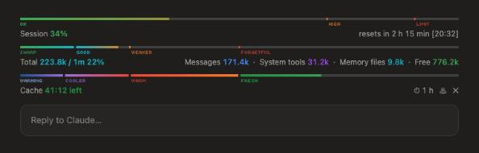

# Context Pane



A Claude Code mod that always shows how full the context window is, just above
the prompt input, as the top row above every other mod's row.

On top, a bar in the same style shows how much of your 5-hour usage window
("Current session" on the usage page) is used, with zones OK (green), HIGH
(orange, from 70%) and LIMIT (red, from 90%), and under it "Session 24%" and
when it resets, as a countdown and a clock time ("resets in 2 h 14 min [20:32]"). On a subscription only.

- A 4 px bar across the full width of the chat, coloured by zone: a gradient
  that takes each zone's label colour from its marker on. A marker the fill
  has passed shows as a small gap in the bar.
- Markers where Claude's recall changes, each with a small all-caps label
  left-aligned under it:

  | Context used | Label | What to expect |
  |---|---|---|
  | Under ~125k | SHARP | Recalls details and follows instructions reliably |
  | ~125k–250k | GOOD | Early details start to blur |
  | ~250k–500k | WEAKER | Misses details; early instructions lose their pull |
  | 500k+ | FORGETFUL | Fine for broad work, not for old specifics |
  | Auto-compact point | AUTO-COMPACT | Older parts get summarised away |

  The zone you are in now is full colour; the others are faded.
- A line of small text: on the left, the total (tokens used / window and
  percent), in the colour of the zone it is in, as that zone's label; on the right, the three
  biggest categories from `/context` and the free space.

- A second bar under it, the same size and style, counting down the time left
  before the prompt cache goes cold. It starts after Claude's first reply and
  restarts after every reply; the cache length (5 min or 1 hour) is read from
  the chat's own log (`bin/ttl.py`). Until that log answers, it uses the length
  found last time (1 hour if never found) and checks again every 5 s. The fill is the share of cache time left,
  so it drains from right to left:

  | Time left | Label | Colour |
  |---|---|---|
  | 50–100% | FRESH | deep green shading to light green |
  | 25–50% | WARM | orange shading to red |
  | 10–25% | COOLER | violet |
  | Under 10% | WARNING | stone-cold blue (its label light blue in dark mode) |

  Once the cache is lost the bar empties and turns grey, markers and labels
  too, and the text reads "Cache lost".

  Under it: the time left on the left; on the right "Keep warm" (orange) while it
  runs, then three icon buttons: ⏱ 1 h / ⏱ 5 min shows the cache length and
  switches it by hand (remembered in every chat; `/context-pane auto` reads it
  from the chat's log again — it changes only the timer, not the cache Claude
  Code uses), ♨ starts and stops Keep warm
  (quiet while off, a lit button while it runs) and ✕ hides the cache bar.

  Keep warm sends one small background ping about 45 s before the cache would
  go cold, so it stays warm while you are away. It stops when you send a
  message, after 30 pings or after 2 hours. Pings are logged to
  `~/.claude/mods-logs/context-pane-cache.log`.

The figures refresh after every turn and are estimated locally, so the row
makes no extra model calls. In a terminal, which draws no images, it shows a
text bar instead.

Commands:

- `/context-pane` hides or shows the whole row.
- `/context-pane 1h` or `/context-pane 5m` sets the cache timer, as the ⏱
  switch does; `/context-pane auto` reads it from the chat's log again.
- `/context-pane cache` hides or shows the cache bar (remembered in every chat).
- `/context-pane keepwarm` and `/context-pane keepwarm off` start and stop
  Keep warm.
- `/context-pane demo` runs one 60 s countdown, for filming, then goes back
  to your setting (1 h or 5 min) by itself.
- `/context-pane auto` reads the cache length from the chat again, and also
  undoes a length set with ⏱ or `1h` / `5m`.

The zone labels are drawn in [Tiny5](https://github.com/Gissio/font_tiny5),
a pixel font for small displays, built into the mod as a 1.4 KB subset under the
SIL Open Font License 1.1 (`fonts/OFL-Tiny5.txt`).

## Requirements

- Claude Code 2.1.287 or newer in the terminal, or 2.1.286 or newer in the
  desktop Code tab.
- `python3` on the computer, to read the cache length (5 min or 1 hour) from the
  chat's log. Without it the cache bar guesses 1 hour.
- The session bar shows only on a Claude subscription (Pro or Max); with an API
  key there are no session figures.

## Install

Type this at the Claude Code prompt in a terminal session:

```
/plugin install context-pane --marketplace FrankPluto/context-pane
```

Answer `y` to add the marketplace, then pick a scope (user installs it for every
project). Start a new session afterwards and the bars appear above the prompt.

### From a downloaded copy

**Desktop app:** unzip the file, then click **+** next to the prompt box →
**Plugins** → **Add marketplace**, enter the path of the unzipped
`context-pane` folder, then **Add plugin** → `context-pane`.

**Terminal:**

```
claude plugin marketplace add /path/to/context-pane
claude plugin install context-pane@context-pane
```
