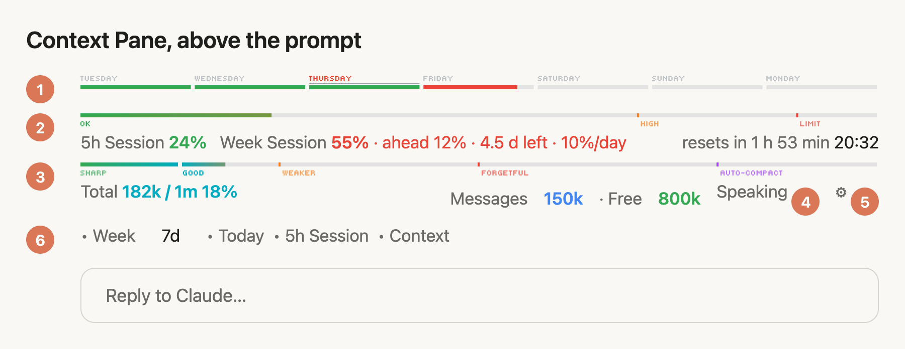
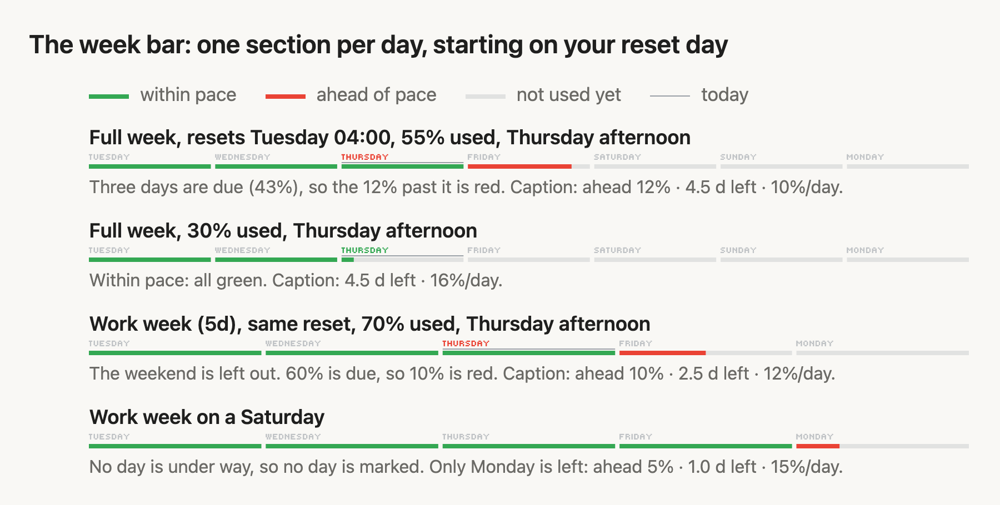

# context-pane

A Claude Code mod that puts live bars just above the prompt, so you can see at a glance how much you have left:

- **Week bar**: your weekly usage, one section per day, starting on the day your week resets. Green is within pace, red is ahead of it, with days left counting down to the reset.
- **5h Session**: your 5-hour usage window and when it resets.
- **Context**: how full the context window is, with recall zones (SHARP, GOOD, WEAKER, FORGETFUL, AUTO-COMPACT).
- **Read aloud**: a speaker that reads replies aloud (macOS).

<picture>
  <source media="(prefers-color-scheme: dark)" srcset="plugins/context-pane/docs/context-pane-dark.png">
  
</picture>

<picture>
  <source media="(prefers-color-scheme: dark)" srcset="plugins/context-pane/docs/week-bar-dark.png">
  
</picture>

## Install

In a terminal:

```
claude plugin marketplace add FrankPluto/context-pane
claude plugin install context-pane@frank-mods
```

Start a new session and the bars appear above the prompt. In the desktop app: **+** next to the prompt box → **Plugins** → **Add marketplace** → `FrankPluto/context-pane`, then add `context-pane`.

To update later:

```
claude plugin marketplace update frank-mods
claude plugin update context-pane@frank-mods
```

## Credits

The pixel font in the bars is [Tiny5](https://github.com/Gissio/font_tiny5),
under the SIL Open Font License (see `plugins/context-pane/fonts/OFL-Tiny5.txt`).

## Learn more

The full manual, with every setting and the `/context-pane` command, is in [plugins/context-pane/README.md](plugins/context-pane/README.md).

Needs a Claude subscription (Pro or Max) for the usage bars.

## License

[MIT](LICENSE): free to use, copy and change, as long as the copyright notice stays. The Tiny5 font keeps its own SIL Open Font License.
