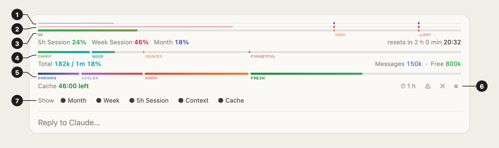

# Context Pane

A Claude Code mod that keeps your usage, your context window and your prompt
cache in sight, as thin bars just above the prompt. Every bar can be switched
off, and a fresh install starts with all of them on.



## What each section shows

| # | Section | What it tells you |
|---|---|---|
| 1 | **Month** line | How much of a monthly usage window is used. Shown only when Claude Code reports one; today it reports no monthly window, so the line stays hidden. Indigo. |
| 2 | **Week** line | How much of your 7-day usage window is used ("Week Session" in the caption). Pink. |
| 3 | **5h Session** bar | How much of your 5-hour usage window ("Current session" on the usage page) is used, and when it resets: a countdown and the clock time, e.g. "resets in 2 h 14 min 20:32". |
| 4 | **Context** bar | How full the context window is, with Claude's recall zones. Under it: the total on the left, the three biggest categories and the free space on the right. |
| 5 | **Cache** bar | Time left before the prompt cache goes cold, with three buttons: ⏱ the cache length, ♨ Keep warm, ✕ hide the bar. |
| 6 | **⚙** | Opens and closes the switches. It sits at the end of the lowest row shown. |
| 7 | **Switches** | One per bar: ● on, ○ off. Press one to show or hide that bar. |

### Usage lines and the session bar (1–3)

The month and week lines are 1 px lines with the same zone markers as the
session bar under them, so all three can be read at a glance. The zones are the
same for all three:

| Used | Zone | Session colour |
|---|---|---|
| Under 70% | OK | green |
| 70–90% | HIGH | orange |
| 90–100% | LIMIT | red |

The figures come from the same source as the status line, so they show only on
a Claude subscription (Pro or Max). With an API key there are no usage figures,
and these rows stay hidden.

### Context bar (4)

The fill takes each zone's colour from its marker on. A marker the fill has
passed shows as a small gap in the bar. The zone you are in now is full colour;
the others are faded.

| Context used | Label | What to expect |
|---|---|---|
| Under ~125k | SHARP | Recalls details and follows instructions reliably |
| ~125k–250k | GOOD | Early details start to blur |
| ~250k–500k | WEAKER | Misses details; early instructions lose their pull |
| 500k+ | FORGETFUL | Fine for broad work, not for old specifics |
| Auto-compact point | AUTO-COMPACT | Older parts get summarised away |

### Cache bar (5)

Counts down the time left before the prompt cache goes cold. It starts after
Claude's first reply and restarts after every reply. The cache length (5 min or
1 hour) is read from the chat's own log (`bin/ttl.py`); until that answers it
uses the length found last time (1 hour if never found). The fill is the share
of cache time left, so it drains from right to left:

| Time left | Label | Colour |
|---|---|---|
| 50–100% | FRESH | deep green shading to light green |
| 25–50% | WARM | orange shading to red |
| 10–25% | COOLER | violet |
| Under 10% | WARNING | stone-cold blue |

Once the cache is lost the bar turns grey and reads "Cache lost".

- **⏱ 1 h / ⏱ 5 min** shows the cache length and switches it by hand
  (remembered in every chat). It changes only the timer, not the cache Claude
  Code uses.
- **♨ Keep warm** sends one small background ping about 45 s before the cache
  would go cold, so it stays warm while you are away. "Keep warm" shows in
  orange while it runs. It stops when you send a message, after 30 pings or
  after 2 hours. Pings are logged to `~/.claude/mods-logs/context-pane-cache.log`.
- **✕** hides the cache bar (the same as its switch) and stops Keep warm.

## Switches

Each bar has a switch, and every switch starts **on** when the mod is
installed. A choice is saved as the mod's setting, so it holds in every chat
until you change it. There are three ways to flip one:

1. **In the row:** press **⚙**, then a switch: **Month**, **Week**,
   **5h Session**, **Context** or **Cache**. Press **⚙** again to close them.
   With every bar off, a short "all bars off" line keeps the **⚙** in place.
2. **With a command:** `/context-pane month`, `/context-pane week`,
   `/context-pane session`, `/context-pane context` or `/context-pane cache`
   switches that bar. `/context-pane switches` opens or closes the switches.
3. **In settings:** in a terminal session, `/config` lists them as Month bar,
   Week bar, 5h Session bar, Context bar and Cache bar. You are also asked for
   them when you install the mod from a terminal.

## All commands

| Command | What it does |
|---|---|
| `/context-pane` | Hides or shows the whole row, for this chat |
| `/context-pane month` · `week` · `session` · `context` · `cache` | Switches that bar on or off |
| `/context-pane switches` | Opens or closes the switches |
| `/context-pane 1h` · `5m` | Sets the cache timer, as ⏱ does |
| `/context-pane auto` | Reads the cache length from the chat's log again |
| `/context-pane keepwarm` · `keepwarm off` | Starts or stops Keep warm |
| `/context-pane demo` | Runs one 60 s cache countdown, for filming, then goes back to your setting |

The figures refresh after every turn and are estimated locally, so the row
makes no extra model calls. In a terminal, which draws no images, each bar is a
text bar instead.

## Requirements

- Claude Code 2.1.287 or newer in the terminal, or 2.1.286 or newer in the
  desktop Code tab.
- `python3` on the computer, to read the cache length from the chat's log.
  Without it the cache bar guesses 1 hour.
- A Claude subscription (Pro or Max) for the usage lines and the session bar.

## Install

Type this at the Claude Code prompt in a terminal session:

```
/plugin install context-pane --marketplace FrankPluto/context-pane
```

Answer `y` to add the marketplace, then pick a scope (user installs it for every
project). Start a new session afterwards and the bars appear above the prompt.

To update later: `claude plugin marketplace update context-pane`, then
`claude plugin update context-pane@context-pane`, and start a new session.

### From a downloaded copy

**Desktop app:** unzip the file, then click **+** next to the prompt box →
**Plugins** → **Add marketplace**, enter the path of the unzipped
`context-pane` folder, then **Add plugin** → `context-pane`.

**Terminal:**

```
claude plugin marketplace add /path/to/context-pane
claude plugin install context-pane@context-pane
```

## Font

The zone labels are drawn in [Tiny5](https://github.com/Gissio/font_tiny5), a
pixel font for small displays, built into the mod as a 1.4 KB subset under the
SIL Open Font License 1.1 (`fonts/OFL-Tiny5.txt`).
