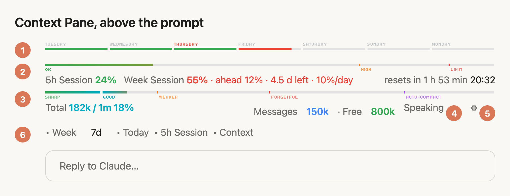
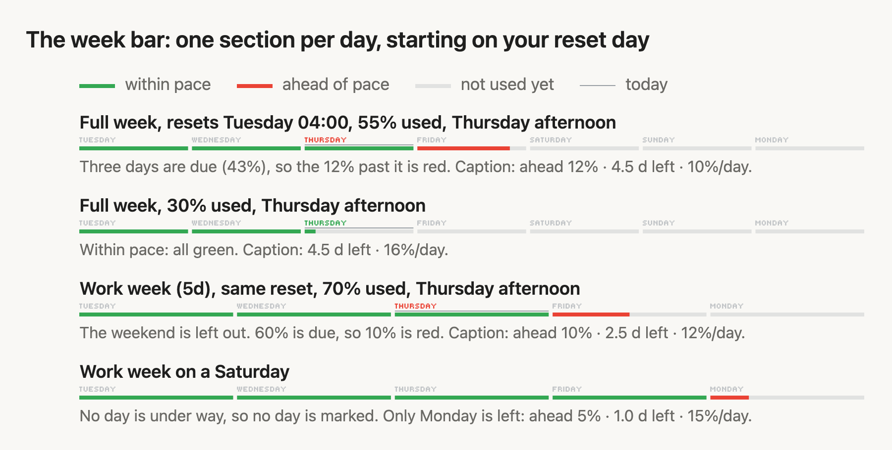

# Context Pane — manual

*Version 2.0.0.* A Claude Code mod that keeps your usage and your context window
in sight, as thin bars just above the prompt, and can read Claude's replies
aloud. Every bar can be switched off, and a fresh install
starts with all of them on.

<picture>
  <source media="(prefers-color-scheme: dark)" srcset="docs/context-pane-dark.png">
  
</picture>

*The numbers in the picture match the table below. The picture is drawn from
the mod's own output, with the settings row open. Light and dark are both
supported.*

## What each part shows

| # | Part | What it tells you |
|---|---|---|
| 1 | **Week bar** | Your 7-day usage, one section per day (7, or 5 for a work week). Green is usage within pace, red is usage ahead of it. A light grey bar above a section marks today. See [The week bar](#the-week-bar). |
| 2 | **5h Session bar** | How much of your 5-hour usage window ("Current session" on the usage page) is used, and when it resets: a countdown and the clock time, e.g. "resets in 2 h 14 min 20:32". The caption above it also carries the week's figures. |
| 3 | **Context bar** | How full the context window is, with Claude's recall zones. Under it: the total on the left, the three biggest categories and the free space on the right. |
| 4 | **Speaking / Silent** | Read aloud. A text button: **Speaking** when on, **Silent** when off; press it to switch. It sits just before ⚙. |
| 5 | **⚙** | Opens and closes the settings row. It sits at the end of the lowest row shown. |
| 6 | **Settings row** | A small dot • is on, a ring ◦ is off. The week controls come first, right after **Week**: **7d / 5d** and **Today**. Then **5h Session** and **Context**. |
| – | **Month line** | A thin line for a monthly usage window. Drawn above the week bar only when Claude Code reports one; today it does not, so it stays hidden. It has no switch. |

## The week bar

<picture>
  <source media="(prefers-color-scheme: dark)" srcset="docs/week-bar-dark.png">
  
</picture>

The week bar answers one question: **am I spending my weekly limit too fast?**

**Sections.** The bar has one section per day: 7 for a **full week**, or 5 for a
**work week** (Mon–Fri). Each day is worth an equal share of the weekly limit:
about 14.3% in a full week, 20% in a work week.

**Which days.** The 7-day window is cut into 24-hour days counted from when the
window started (one week before the weekly reset), not from midnight. In a work
week only the Mon–Fri days count, so a weekend adds no budget. The weekday is
the local one, worked out with the system's `date` command.

**Day names.** Each section has its day's name above it (`TUESDAY WEDNESDAY … MONDAY`),
and the bar starts on the weekday your week resets, not on Monday. If the week
resets Tuesday 04:00, the first section runs Tue 04:00 – Wed 04:00 and the last
one Mon 04:00 – Tue 04:00. Today's name is green while you are within pace and red once you are ahead; the rest are faded grey. In
a work week the weekend is left out, so a Tuesday reset reads `TUESDAY … FRIDAY MONDAY`.

**Colours.** The days up to and including today are *due* so far. Usage up to
that point is **green**. Usage beyond it is **red**: you have already spent the
budget of days still to come. Unused parts of a section are grey.

**The caption** next to *Week Session* reads like
`55% · ahead 12% · 4.5 d left · 10%/day`:

| Part | Meaning |
|---|---|
| `55%` | Share of the weekly limit used. Green while within pace, red once ahead. |
| `ahead 12%` | Usage minus what is due so far. Shown only when you are ahead. |
| `4.5 d left` | Counted days left until the reset, with what is left of today as a fraction: `7.0 d left` just after a reset, `6.3 d left` that evening. In a work week weekend hours do not count. |
| `10%/day` | What is left of the limit, spread over those days. |
| `last day · 20% left` | Shown on the last counted day. `no work days left` on a weekend after the last one. |

**Worked example (full week, 55% used, on day 3).** Three days are due, which is
3 × 14.3% = 42.9%. You have used 55%, so you are 12% ahead: the first 42.9% is
green and the next 12% is red, in day 4. The 45% that is left, over the 4.5 days
left until the reset, is 10% a day.

**Today.** A light grey bar, 1 px tall, sits just above today's section. It is
still; nothing in the bar moves. It is hidden on a weekend in a work week, when
no counted day is under way. Switch it with **Today** in the settings row or
`/context-pane today`. The space for it is always kept, so nothing jumps when
you switch it.

**When the reset time is unknown.** If Claude Code does not report when the
week resets, the bar still splits into days but stays all green, with no red
and no *d left* note.

**Switching between 5 and 7 days.** Press **7d** / **5d** in the settings row,
or use `/context-pane 5d` and `/context-pane 7d`. It is saved as the setting
`workWeek`, so it holds in every chat.

## The 5h session bar

Shows how much of the 5-hour usage window is used and when it resets. Its zones
are:

| Used | Zone | Colour |
|---|---|---|
| Under 70% | OK | green |
| 70–90% | HIGH | orange |
| 90–100% | LIMIT | red |

The figures come from the same source as the status line, so they show only on
a Claude subscription (Pro or Max). With an API key there are no usage figures,
and the session and week bars stay hidden.

## The context bar

The fill takes each zone's colour from its marker on. A marker the fill has
passed shows as a small gap in the bar. The zone you are in now is full colour;
the others are faded. The **AUTO-COMPACT** label is light purple in dark mode so
it stays readable.

| Context used | Label | What to expect |
|---|---|---|
| Under ~125k | SHARP | Recalls details and follows instructions reliably |
| ~125k–250k | GOOD | Early details start to blur |
| ~250k–500k | WEAKER | Misses details; early instructions lose their pull |
| 500k+ | FORGETFUL | Fine for broad work, not for old specifics |
| Auto-compact point | AUTO-COMPACT | Older parts get summarised away |

## Read aloud

With Read aloud on, each of Claude's replies in the main chat is read aloud
with macOS `say`, from start to finish. Code blocks, link addresses and
formatting symbols are skipped. A new reply cuts off one still being read, and
switching it off stops the reading at once. Helpers' replies and interrupted
replies are not read. It is on after install. Its switch is the **Speaking /
Silent** button beside ⚙ (it is not in the settings row), or
`/context-pane speak`. The voice is the one set in System Settings →
Accessibility → Spoken Content.

## Switching things on and off

Each bar has a switch, and every switch starts **on** when the mod is
installed (the work week starts off, so the week bar shows 7 days). A choice is
saved as the mod's setting, so it holds in every chat until you change it.
There are three ways to flip one:

1. **In the row:** press **⚙**, then a switch: **Week**, **5h Session**,
   **Context**; **7d / 5d**; **Today**. Press **⚙** again to close
   the row. With every bar off, a short "all bars off" line keeps the **⚙** in
   place.
2. **With a command:** see the table below.
3. **In settings:** in a terminal session, `/config` lists them by the titles in
   the settings table further down. You are also asked for them when you
   install the mod from a terminal.

## All commands

| Command | What it does |
|---|---|
| `/context-pane` | Hides or shows the whole row, for this chat |
| `/context-pane week` · `session` · `context` | Switches that bar on or off |
| `/context-pane switches` | Opens or closes the settings row |
| `/context-pane 5d` · `7d` | Splits the week bar into a work week or a full week |
| `/context-pane today` | Switches the grey bar above today on or off |
| `/context-pane speak` | Switches Read aloud on or off |

The figures refresh after every turn and are estimated locally, so the row
makes no extra model calls. In a terminal, which draws no images, each bar is a
text bar instead, and the settings row has the same buttons.

## Settings

Saved per user, read again at the start of every chat.

| Key | Title | Default | What it does |
|---|---|---|---|
| `showWeek` | Week bar | on | The 7-day usage window as a 4 px bar with one section per day: green within pace, red ahead of it. |
| `showSession` | 5h Session bar | on | The 5-hour usage window, with when it resets. |
| `showContext` | Context bar | on | How full the context window is, with recall zones. |
| `readAloud` | Read aloud | on | Read each of Claude's replies aloud (macOS). The speaker next to ⚙ switches it. |
| `workWeek` | Week bar: work week | off | Split the week bar into 5 days (work week, Mon–Fri) instead of 7 (full week). The ⚙ switches show it as 5d / 7d. |
| `showToday` | Week bar: Today marker | on | A light grey bar, 1 px tall, just above the day section of the week bar we are in now. The ⚙ switches show it as Today. |

## How it works

The mod is one hooks module (`hooks/register.tsx`) with helpers beside it.

- It draws into the strip above the prompt (the `AbovePrompt` slot) as its top
  row, above other mods' rows. Bars are small SVG drawings; the zone labels use
  the Tiny5 pixel font built into the drawing.
- After each turn (`session.measure`) it reads the same figures `/context`
  shows: context size and categories, the 5-hour and 7-day limits with their
  reset times. It makes no model calls to do so.
- The week bar's pace is worked out in `weekPace` and drawn by `weekSvg`; the
  weekday of the window start is read once per weekly reset.
- `hooks/bars.ts` holds the on/off state and the saved settings (bars, 5d/7d,
  Today); `hooks/speech.ts` holds Read aloud.
- State is kept per chat in the session; the settings above are saved across
  chats.

## Requirements

- Claude Code 2.1.287 or newer in the terminal, or 2.1.286 or newer in the
  desktop Code tab.
- A Claude subscription (Pro or Max) for the usage lines and the session bar.
- macOS for Read aloud (it uses the built-in `say`).

## Install

The mod lives in the `frank-mods` marketplace, on GitHub at
[FrankPluto/context-pane](https://github.com/FrankPluto/context-pane). In a terminal:

```
claude plugin marketplace add FrankPluto/context-pane
claude plugin install context-pane@frank-mods
```

Start a new session afterwards and the bars appear above the prompt. In the
desktop app: click **+** next to the prompt box → **Plugins** → **Add
marketplace**, enter `FrankPluto/context-pane`, then **Add plugin** → `context-pane`.

To update after changing the files:

```
claude plugin marketplace update frank-mods
claude plugin update context-pane@frank-mods
```

then restart. (Bump `version` in `.claude-plugin/plugin.json` and in
`.claude-plugin/marketplace.json` first, or the update finds nothing new.)

## For developers

```
claude plugin validate  "<this folder>"   # checks the manifest and the module
claude plugin test      "<this folder>"   # runs hooks/register.test.tsx (46 tests)
```

The tests mount the real row on the terminal and the desktop and check what it
draws, including the week bar's pace, the 5d/7d switch and the saved settings.

## Font

The zone labels are drawn in [Tiny5](https://github.com/Gissio/font_tiny5), a
pixel font for small displays, built into the mod as a 1.4 KB subset under the
SIL Open Font License 1.1 (`fonts/OFL-Tiny5.txt`).
